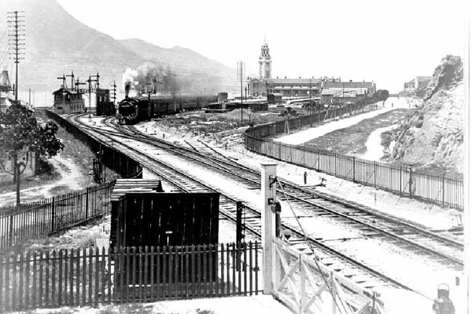

# plates — Histsyn research-paper plate images

*Cover photo: the Kowloon-Canton Railway terminus at Tsim Sha Tsui,
c. 1916 — the clock tower standing beside the station building five years
after the line opened (the clock was fitted in 1921). Photograph by
**Wrightbus**, via Wikimedia Commons — **public domain**;
source: https://commons.wikimedia.org/wiki/File:Kcr_tst_1916.jpg
(accessed 10 October 2026).*

Plate images (illustrations) for the research papers published by
[Histsyn](https://www.histsyn.com/), served over GitHub Pages:

**`https://histsyn.github.io/plates/<topic>/images/<file>`**

Why here: the Blogger API cannot upload media, and GitHub Pages serves every
file with `Access-Control-Allow-Origin: *`, so the same URL works in a blog
post, in a paper's `<figure class="plate">`, and in any script that later
reads the pixels.

Layout mirrors the research workspace: `KCROpening1910/images/…`, and future
topics drop their plates in their own `<topic>/images/…`.

Provenance of everything in this repo is recorded per file below; each plate
also carries its credit line in the `figcaption` of the paper it illustrates.
Do not add an image here without a source, a licence and a credit line.

## KCROpening1910 — The Week the Railway Opened (KCR British Section, 1910–1911)

| file | what it shows | source | credit / licence |
|---|---|---|---|
| `gaz_1910-10-07_no317_certificate_crop.jpg` | Government Gazette, 7 Oct 1910, Notification No. 317 — E. S. Lindsey's Section 16 certificate; the highlighted line is "opened for the public carriage of passengers on the 1st instant" | https://hkintexts.histsyn.com/image-page/1477021 | Government Gazette (Hong Kong), 7 Oct 1910, No. 317; hkintexts image series, accessed 10 Oct 2026. Public record. |
| `ar1910_appR_opened_for_traffic_crop.jpg` | Administrative Report 1910, Appendix R — "The Railway was opened for traffic on the 1st October." | https://hkintexts.histsyn.com/image-page/418389 | Administrative Report 1910 (Hong Kong), Appendix R; hkintexts image series, accessed 10 Oct 2026. Public record. |
| `gaz_1910-09-30_no297_rules_crop.jpg` | Government Gazette, 30 Sep 1910, Notification No. 297 — the rulebook's rules 6 and 10 | https://hkintexts.histsyn.com/image-page/1476971 | Government Gazette (Hong Kong), 30 Sep 1910, No. 297; hkintexts image series, accessed 10 Oct 2026. Public record. |
| `gaz_1910-06-10_no181_plant_sale_crop.jpg` | Government Gazette, 10 Jun 1910, Notification No. 181 — sale of railway construction plant and stores | https://hkintexts.histsyn.com/image-page/1476808 | Government Gazette (Hong Kong), 10 Jun 1910, No. 181; hkintexts image series, accessed 10 Oct 2026. Public record. |
| `ar1910_p17_terminus_lots_crop.jpg` | Administrative Report 1910, p. 17, item 118 — Kowloon Inland Lots 442 and 618 | https://hkintexts.histsyn.com/image-page/418350 | Administrative Report 1910 (Hong Kong), p. 17; hkintexts image series, accessed 10 Oct 2026. Public record. |
| `cm_1911-10-05_p5_chinese_section_crop.jpg` | *China Mail*, 5 Oct 1911, p. 5 — "OPENING OF CHINESE SECTION" | https://hkintexts.histsyn.com/image-page/1711804 | *China Mail*, 5 Oct 1911, p. 5; hkintexts image series, accessed 10 Oct 2026. Public record (1911 newspaper). |
| `web_kcr_tst_station_1916_pd.jpg` | The KCR terminus at Tsim Sha Tsui, c. 1916, clock tower before the clock was fitted | https://commons.wikimedia.org/wiki/File:Kcr_tst_1916.jpg | Wrightbus, via Wikimedia Commons — **public domain** (no licence required; credit printed for provenance). |
| `web_clocktower_mk2010_cc.jpg` | The surviving Clock Tower at Tsim Sha Tsui today | https://commons.wikimedia.org/wiki/File:Former_Kowloon-Canton_Railway_Clock_Tower,_Tsim_Sha_Tsui_(Hong_Kong).jpg | Mk2010, own work, 30 May 2015 — **CC BY-SA 4.0**; author, licence and link must appear in the caption. |

The highlighted crops were produced by the workspace tool
`tools/scan_highlights.py`, which paints the quoted line on the scan; every
highlight was checked by eye before use.

## MotorBus1920s — The Buses' Free-for-All and the 1933 Settlement (1919–1933)

| file | what it shows | source | credit / licence |
|---|---|---|---|
| `gaz_1933-01-13_S10_award_crop.jpg` | Government Gazette, 13 Jan 1933, Notification No. S. 10 — the franchise award: Island to the China Motor Bus Co., Kowloon and the New Territories to the Kowloon Motor Bus Co.; highlighted line "Tender for Road Passenger Transport." | https://hkintexts.histsyn.com/image-page/1486572 | Government Gazette (Hong Kong), 13 Jan 1933, No. S. 10; hkintexts image series, accessed 10 Oct 2026. Public record. |
| `gaz_1932-09-02_S319_tender_crop.jpg` | Government Gazette, 2 Sep 1932, Notification S. 319 — the fifteen-year franchise tender terms; highlighted line "The licence or licences will be for a period or term of Fifteen years commencing" (next line: "on the 11th day of June, 1933") | https://hkintexts.histsyn.com/image-page/1484336 | Government Gazette (Hong Kong), 2 Sep 1932, S. 319; hkintexts image series, accessed 10 Oct 2026. Public record. |
| `gaz_1926_kaitack_liquidation_crop.jpg` | Gazette supplement, 1926 (printed p. 577) — the first Kai Tack Motor Bus Company in voluntary liquidation; creditors' meeting 12 Oct 1926 at 26 Des Voeux Road Central; highlighted line "(In Voluntary Liquidation)" | https://hkintexts.histsyn.com/image-page/1458491 | Government Gazette (Hong Kong), 1926 supplement, printed p. 577; hkintexts image series, accessed 10 Oct 2026. Public record. |
| `gaz_1933-08-04_no529_strikeoff_crop.jpg` | Government Gazette, 4 Aug 1933, No. 529 — the Kai Tack Motor Bus Company (1926), Limited strike-off warning; highlighted line "…be struck off the register and the company will be dissolved." | https://hkintexts.histsyn.com/image-page/1489491 | Government Gazette (Hong Kong), 4 Aug 1933, No. 529; hkintexts image series, accessed 10 Oct 2026. Public record. |
| `web_kmb_thornycroft_pd.jpg` | A KMB Thornycroft CD4LW Cygnet single-deck bus, late 1930s (KMB bought 17 of this chassis 1938-39); destination blind "STAR FERRY 尖沙咀", route 6, front plate …779 | https://commons.wikimedia.org/wiki/File:KMB_Thornycroft_CD4LW_Cygnet.jpg | Unknown author, via Wikimedia Commons — **public domain** (credit printed for provenance). |
| `web_praya_bus_1930s_pd.jpg` | A 1930s street scene on Connaught Road Central with a single-deck bus toward the camera ("Central Connaught Road in the 1930s" per the Commons description) | https://commons.wikimedia.org/wiki/File:1930s_praya_central-gpo_bus.jpg | Unknown author, via Wikimedia Commons — **public domain** (credit printed for provenance). |

MotorBus1920s plates were read and verified with `tools/read_image.py`
(GLM-5.3-Flash via the NVIDIA endpoint) before use — the 2026-10-10 image pass.

## FirstCar1900 — The Dentist, the Young Master and the Proud Possessor (Hong Kong's first automobile, 1888–1968)

| file | what it shows | source | credit / licence |
|---|---|---|---|
| `cm_1890_noble_return_crop.jpg` | *China Mail*, 8 Apr 1890, p. 1 — the POATE & NOBLE, Dental Surgeons advertisement; highlighted notice "DR. NOBLE has Returned to the Colony and RESUMED PRACTICE. Hongkong, April 5, 1890." | https://hkintexts.histsyn.com/image-page/1204943 | *China Mail*, 8 Apr 1890, p. 1; hkintexts image series, accessed 10 Oct 2026. Public record (1890 newspaper). |
| `dir_1908_dentists_crop.jpg` | *Directory and Chronicle* 1908, p. 1164 — the classified DENTISTS list: "Kew Brothers / Noble, Dr. J. W. / Wilson, Dr. Newell" — both dentists of the first-car story in one list; highlighted "Kew Brothers, Dr." | https://hkintexts.histsyn.com/image-page/1035667 | *Directory and Chronicle* 1908, p. 1164; hkintexts image series, accessed 10 Oct 2026. Public record. |
| `dir_1910_kew_motor_crop.jpg` | *Directory and Chronicle* 1910, p. 1644 — the Kew family entries: three dentists + "Kew, J. W., consulting and motor engineer, J. W. Kew & Co., Hongkong"; highlighted "Kew, J. W., consulting and motor engineer" | https://hkintexts.histsyn.com/image-page/923492 | *Directory and Chronicle* 1910, p. 1644; hkintexts image series, accessed 10 Oct 2026. Public record. |
| `cm_1912_noble_knox_crop.jpg` | *China Mail*, 12 Aug 1912, p. 2 — the Motor Car Regulations letter; highlighted "of Dr. J. W. Noble, the pioneer motorist" (the image-index OCR layer misread "Nohle"; the scan reads "Noble") | https://hkintexts.histsyn.com/image-page/1714128 | *China Mail*, 12 Aug 1912, p. 2; hkintexts image series, accessed 10 Oct 2026. Public record (1912 newspaper). |
| `web_oldsmobile_curveddash_1905_cc.jpg` | A 1905 Oldsmobile Curved Dash Runabout — the single-cylinder, chain-driven type the 1931 Hodgson talk describes for Hong Kong's first car ("one cylinder, chain driven with the engine at the rear"). An illustration of the TYPE, not the actual 1908 Hong Kong car | https://commons.wikimedia.org/wiki/File:Oldsmobile_Curved_Dash_Runabout_1905.jpg | Lars-Göran Lindgren Sweden, via Wikimedia Commons — **CC BY-SA 3.0**; author, licence and link must appear in the caption. |

FirstCar1900 plates were read and verified by eye (vision-capable research model,
opencode `read`) before use — the 2026-10-10 image pass.

## FirstCinema — The Blurred First Pictures (Hong Kong's cinema, 1894–1916)

| file | what it shows | source | credit / licence |
|---|---|---|---|
| `crop_1897_ad.jpg` | *China Mail*, 24 Apr 1897, p. 2 — the first-exhibition advertisement: "CITY HALL—MUSIC ROOM. FOR THE FIRST TIME IN HONG-KONG. THE CINEMATOGRAPH… Admission:—ONE DOLLAR; Children, half-price." | https://hkintexts.histsyn.com/image-page/1214945 | *China Mail*, 24 Apr 1897, p. 2; hkintexts image series, accessed 10 Oct 2026. Public record (1897 newspaper). |
| `crop_opening_ad.jpg` | *China Mail*, 27 Oct 1900, p. 5 — the opening-night advertisement: "GRAND OPENING NIGHT TUESDAY, the 30th October… The TRANSVAAL WAR, THE BOER BATTERY CAPTURED BY BRITISH!" | https://hkintexts.histsyn.com/image-page/1311491 | *China Mail*, 27 Oct 1900, p. 5; hkintexts image series, accessed 10 Oct 2026. Public record. |
| `crop_complaint_date.jpg` | *China Mail*, 31 Oct 1900, p. 2 — the complaint letter's opening: "Last night… the so-called 'Grand Exhibition of Cinematograph,' 'The Animated Moving Pictures of the Transvaal War.'" | https://hkintexts.histsyn.com/image-page/1311504 | *China Mail*, 31 Oct 1900, p. 2; hkintexts image series, accessed 10 Oct 2026. Public record. |
| `crop_salon_first_ad.jpg` | *China Mail*, 30 Dec 1909, p. 8 — the Salon Cinema Theatre's first advertisement: "THE ONLY FIRST-CLASS SHOW IN THE COLONY… WYNDHAM (FLOWER) STREET, OPPOSITE G. P. O." | https://hkintexts.histsyn.com/image-page/1334720 | *China Mail*, 30 Dec 1909, p. 8; hkintexts image series, accessed 10 Oct 2026. Public record. |
| `crop_regs_1909.jpg` | *Government Gazette*, 20 Aug 1909, p. 573 — the cinematograph fire regulations: iron/asbestos box, six feet from the audience, "two buckets of water and a wetted blanket." | https://hkintexts.histsyn.com/image-page/1473925 | *Hong Kong Government Gazette*, 20 Aug 1909, p. 573; hkintexts image series, accessed 10 Oct 2026. Public record. |
| `crop_ord_1910.jpg` | *Government Gazette*, 22 Jul 1910, p. 292 — No. 17 of 1910, the Ordinance to amend the Theatres and Public Performances Regulation Ordinance, 1908 (the censorship clause). | https://hkintexts.histsyn.com/image-page/1476843 | *Hong Kong Government Gazette*, 22 Jul 1910, p. 292; hkintexts image series, accessed 10 Oct 2026. Public record. |

FirstCinema plates were read and verified by eye (vision-capable research
model, opencode `read`) before use — the 2026-10-10 image pass; the batch was
then **re-made on 2026-10-11** with `tools/scan_highlights.py` (highlight
boxes re-seated on the ink bands — five plates) except `crop_salon_first_ad.jpg`,
whose OCR layer has no boxes on the ad block and was cropped by eye from the
full scan. The read-back caught a quote error: the 1900 opening ad's
admission is Front Seats $2.00 / Back Seats $1.00, not the 1897 ad's
"ONE DOLLAR" — corrected in the paper, notes and post.

## Heong Kong — The Village That Named the Island (香港村 / 黃竹坑舊圍)

| file | what it shows | source | credit / licence |
|---|---|---|---|
| `heong_kong_context_1881.jpg` | The 1881 defence-committee survey sheet, southern Hong Kong Island: ABERDEEN on the coast, Staunton's Valley running inland, Deep Water Bay. | The National Archives (UK), CO 129/197; *Map of Hong Kong, To Accompany Report of Defence Committee*, 1 October 1881. Crop by this workspace. | Crown copyright 1881; public record. Crop and read 11 Oct 2026. |
| `heong_kong_village_1881_hl.jpg` | The same crop with the place-name **Heong Kong** and its hatched village symbol boxed (red rectangle). | As above; box by this workspace, verified by reading the plate back. | Crown copyright 1881; public record. |
| `heong_kong_label_1881.jpg` | Tight crop of the handwritten label **Heong Kong** beside the village symbol — the period romanization read by the research model's own eyes (the GLM-5.3-Flash proxy misread it twice). | As above. | Crown copyright 1881; public record. |
| `ohk4_1845_villages_hl.jpg` | *Old Hong Kong* vol. 4, p. 151 — the 1845 surveyor's village list with boxes on "that in Heong-kong, (Little Hongkong), Wong-nai-chung, Soo-" and "1st. — Heong-kong, from whence the island derives". | https://hkintexts.histsyn.com/image-page/1587815 | *Old Hong Kong* vol. 4, 151; hkintexts image series, accessed 11 Oct 2026. Public record. |
| `ar1853_school_hl.jpg` | Administrative Reports vol. 1, 1853, p. 191 — Enclosure No. 9, Medhurst's school report of 12 January 1853, with **Heong-Kong** boxed in the average-attendance table (26 boys), between Stanley and Aberdeen. | https://hkintexts.histsyn.com/image-page/1132820 | Administrative Reports 1853 (vol. 1), 191; hkintexts image series, accessed 11 Oct 2026. Public record. |
| `bb1877_census_hl.jpg` | Blue Book 1877, printed p. 128 — the census VILLAGES list with **Heong Kong,** boxed between Aberdeen and Pok-fú Lam (223 / 186). | https://hkintexts.histsyn.com/image-page/2185611 | Blue Book 1877, 131; hkintexts image series, accessed 11 Oct 2026. Public record. |
| `bb1932_townplanning_hl.jpg` | Blue Book 1932, printed p. 422 — the Town Planning lay-outs list with **Little Hong Kong (Aberdeen Valley)** boxed. | https://hkintexts.histsyn.com/image-page/2206965 | Blue Book 1932, 457; hkintexts image series, accessed 11 Oct 2026. Public record. |
| `gaz1937_notice_hl.jpg` | Government Gazette, 24 September 1937, printed p. 716 — Notification No. 682, the road-naming table, with **Wong Chuk Hang** boxed beside its Chinese version 黃竹坑徑. | https://hkintexts.histsyn.com/image-page/1513308 | *Hong Kong Government Gazette*, 24 Sept 1937, 716 (No. 682); hkintexts image series, accessed 11 Oct 2026. Public record. |
| `gaz1937_wchpath_hl.jpg` | Government Gazette, 24 September 1937, index page XLVIII — the roads-and-streets index with **Wong Chuk Hang Path, 716** boxed (the index entry pointing to the No. 682 notice). Supplementary to the notice plate. | https://hkintexts.histsyn.com/image-page/1512614 | *Hong Kong Government Gazette*, 24 Sept 1937, index; hkintexts image series, accessed 11 Oct 2026. Public record. |

Heong Kong plates were made 11 October 2026 with `tools/scan_highlights.py`
(the five document plates; highlight boxes re-seated on the ink bands) and
OpenCV crop/box (the three artefact plates, drawn on the crop of CO 129/197).
Every plate was read back with the research model's own eyes via the `Read`
tool before use; the ohk4 plate's second box had to be redrawn by eye after
the tool seated it one line low.

## Typhoon1937 — The Typhoon That Broke Every Record (2 September 1937)

The 1937 English papers (China Mail / Daily Press) have no image-series twin —
their pictorial record survives only as printed captions. All five plates
below come from the 工商日報 (Kung Sheung Daily Press) scans, the one 1937
series the image index holds.

| file | what it shows | source | credit / licence |
|---|---|---|---|
| `plate1_anlee_photo.jpg` | 工商日報, 3 Sept 1937, p. 9 — the stranded steamer An Lee photographed after her drift, with both vertical captions 「遇險後之安利輪」 and 「(美環攝贈)」 (photo contributed by the Mei Hwan studio); no highlight — a photograph plate. | https://hkintexts.histsyn.com/image-page/469421 | 工商日報, 3 Sept 1937, p. 9; hkintexts image series, accessed 11 Oct 2026. Public record (1937 newspaper); photograph credited 美環 in the printed caption. |
| `plate2_fire_160mph.jpg` | 工商日報, 3 Sept 1937, p. 9 — the Chinese official storm report (「颶風襲擊經過」) columns, four boxes: 「干諾道西一百三十五號失火」, 「焚斃溺斃及受傷之婦孺男子約逾百人」, 「焚斃溺斃及受傷之」 and the wind line 「一百六十里」 (160 m.p.h.). | https://hkintexts.histsyn.com/image-page/469421 | 工商日報, 3 Sept 1937, p. 9; hkintexts image series, accessed 11 Oct 2026. Public record (1937 newspaper). |
| `plate3_taipo_sunk.jpg` | 工商日報, 4 Sept 1937, p. 9 — the New Territories disaster report, boxes on the headline 「大埔墟村竟有一村沉沒」, 「全村陸沉、人畜沒頂」 and 「(如)長洲海面屍浮數百」. | https://hkintexts.histsyn.com/image-page/469433 | 工商日報, 4 Sept 1937, p. 9; hkintexts image series, accessed 11 Oct 2026. Public record (1937 newspaper). |
| `plate4_kcr_notice.jpg` | 工商日報, 8 Sept 1937, p. 9 — the KCR British Section's own Chinese notice 「九廣鐵路啓事」 (printed form 啓), boxes on the headline and the resumption line 「以待修理。約期本月十三日便可恢復行車矣。」 | https://hkintexts.histsyn.com/image-page/469481 | 工商日報, 8 Sept 1937, p. 9; hkintexts image series, accessed 11 Oct 2026. Public record (1937 newspaper). |
| `plate5_editorial_taipo.jpg` | 工商日報, 5 Sept 1937, p. 1 — the editorial 「該想想風災善後的辦法」, box on 「大埔墟中，竟有一村完全沉沒」. | https://hkintexts.histsyn.com/image-page/469437 | 工商日報, 5 Sept 1937, p. 1; hkintexts image series, accessed 11 Oct 2026. Public record (1937 newspaper). |

Typhoon1937 plates were made 11 October 2026: full scans fetched via the
public viewer, highlight boxes drawn at character precision with OpenCV
(the pages' OCR layer is column-interleaved — `tools/scan_highlights.py`
auto-boxes were rejected and every box placed manually, verified against the
printed characters). Every plate was read back with the research model's own
eyes via the `Read` tool before use — plate 2's first nudge attempt was
reverted when the original box proved exact.

## Telephone1882 — The Exchange at Last (the telephone comes to Hong Kong, 1877–89)

Reworked thread, 11 October 2026. Four document plates, all from image-series
twins of the cited pages; each highlight box re-seated by
`tools/scan_highlights.py` and every plate read back with the research model's
own eyes via the `Read` tool before use (plate 1's first auto-box landed on the
wrong paragraph after a -139px drift re-seat and was re-made with a deeper
keyword — "Gower-Bell" — before acceptance).

| file | what it shows | source | credit / licence |
|---|---|---|---|
| `cm1881_singapore_hl.jpg` | The China Mail, 18 Feb 1881, p. 2 — the Singapore comparison editorial; boxes on the "thirty subscribers / ordered from England / Gower-Bell loud-speaking Telephone" lines and the "noisiest offices / monthly subscription of $10" lines. | https://hkintexts.histsyn.com/image-page/1194586 | The China Mail, 18 Feb 1881, p. 2; hkintexts image series, accessed 11 Oct 2026. Public record (1881 newspaper). |
| `cm1881_oriental_agm_hl.jpg` | The China Mail, 21 May 1881, p. 9 — "The Institution of the Telephone Exchange… promises soon to become an accomplished fact in Hongkong"; box on the "Oriental Telephone Comp[any's] … agents … Gibb, Livingstone and Co." line. | https://hkintexts.histsyn.com/image-page/1194915 | The China Mail, 21 May 1881, p. 9; hkintexts image series, accessed 11 Oct 2026. Public record (1881 newspaper). |
| `gaz1881_edison_petition_hl.jpg` | The Hongkong Government Gazette, 28 May 1881, p. 383 — the notice of Joseph Morris's petition (as agent for Thomas A. Edison) for the Carbon Telephone patent; box on "the Carbon Telephone, for which Letters" line. | https://hkintexts.histsyn.com/image-page/1505059 | Hongkong Government Gazette, 28 May 1881; hkintexts image series, accessed 11 Oct 2026. Public record (1881 government gazette). |
| `gaz1881_bell_edison_ad_hl.jpg` | The Hongkong Government Gazette, 12 Nov 1881, p. 1004 — the full "BELL & EDISON'S SYSTEM" advertisement ($150/yr town subscription; boundaries West Gas Works / East Police Station No. 2 / South Caine & Kennedy Roads; signed A. Suenson, 10 Nov 1881); box on the "Permission having been granted" lines. | https://hkintexts.histsyn.com/image-page/1505669 | Hongkong Government Gazette, 12 Nov 1881; hkintexts image series, accessed 11 Oct 2026. Public record (1881 government gazette). |

## GreatStrike1925 — The Strike and the Two Voices (省港大罷工, 1925–26)

Reworked thread, 11 October 2026. Seven document plates, all from
image-series twins of the cited pages (the 1925–26 daily press has no
image twin, so its citations stay text-series). Two of the seven plates
(`ar1925_exodus`, `sp1926_thing_past`) had `scan_highlights.py` OCR boxes
land one line low; both were re-seated by hand with a manual PIL painter
after probe crops read with the research model's own eyes, and every one
of the seven was read back at its final crop before use (the §6B gate).

| file | what it shows | source | credit / licence |
|---|---|---|---|
| `ar1925_exodus_hl.jpg` | Administrative Reports 1925, section C (Labour), printed p. C17 — boxes on "On the 19th men employed by the Hongkong and Macao Steamboat Co. went on strike." and "the strike was almost general. It is estimated that during the first two weeks of the strike over 50,000 persons left the Colony." (hand-seated). | https://hkintexts.histsyn.com/image-page/427008 | Administrative Reports, Hongkong, 1925; hkintexts image series, accessed 11 Oct 2026. Public record. |
| `ar1925_strike_start_hl.jpg` | Administrative Reports 1925, section K (Police), printed p. K15 — box on "anti-strike arrangements from the outbreak of the Strike on June 19th until my return from Wei Hai Wei on July 9th". | https://hkintexts.histsyn.com/image-page/427193 | Administrative Reports, Hongkong, 1925; hkintexts image series, accessed 11 Oct 2026. Public record. |
| `ar1925_labour_bureau_hl.jpg` | Administrative Reports 1925, section K (Police), printed p. K19 — box on "25,000 coolies were collected and sent out to work. 170,000 tons of cargo were handled on behalf of one Company alone" (tonnage clause continues on the next line, visible beneath the box). | https://hkintexts.histsyn.com/image-page/427197 | Administrative Reports, Hongkong, 1925; hkintexts image series, accessed 11 Oct 2026. Public record. |
| `gaz1925_gn367_hl.jpg` | Government Gazette, 19 June 1925, printed p. 319 — Notification No. 367, the export embargo; box on "Except under licence from the Colonial Secretary, the export of the following articles is prohibited:—" (the five-item list follows in view). Regulation dated 22 June 1925 — one day before Shameen. | https://hkintexts.histsyn.com/image-page/1526282 | The Hongkong Government Gazette, 19 June 1925; hkintexts image series, accessed 11 Oct 2026. Public record. |
| `gaz1925_gn561_hl.jpg` | Government Gazette, 9 October 1925, printed p. 472 — Notification No. 561, the embargo's partial removal; box on "as Notification No. 367 shall cease to have force and effect as from the 8th day of October, 1925, as far as concerns the exportation of Rice, Flour," (continues "and Tinned or preserved foodstuffs."). | https://hkintexts.histsyn.com/image-page/1526420 | The Hongkong Government Gazette, 9 October 1925; hkintexts image series, accessed 11 Oct 2026. Public record. |
| `sp1926_thing_past_hl.jpg` | Sessional Paper 1926, No. 8 of 1926, printed p. 79 — box on "Mr. Ch'ên that the strike in Hongkong has long been a thing of the past, but that I have" (hand-seated after the tool's +50px re-seat landed one line low). | https://hkintexts.histsyn.com/image-page/1621714 | Sessional Papers, Hongkong, 1926, No. 8; hkintexts image series, accessed 11 Oct 2026. Public record. |
| `sp1926_robbers_hl.jpg` | Sessional Paper 1926, No. 8 of 1926, printed p. 111 — the translation of the Canton 民國日報 of 27 August 1926; box on "We can reply to the Hong Kong Imperialists thus:—'You are robbers. You" (sentence continues "are pirates. If you are not…" on the next line). | https://hkintexts.histsyn.com/image-page/1621746 | Sessional Papers, Hongkong, 1926, No. 8; hkintexts image series, accessed 11 Oct 2026. Public record. |

The Gazette's running head on the G.N. 367 plate prints "JUNE 19, 1925"
while the regulation itself is dated "this 22nd day of June, 1925" —
cite the printed date of the regulation (22 June) and the plate's printed
page 319.

## HKHotel — The Grand Hotel's First Hundred Years (香港大酒店, 1865–1958)

Redo thread, 11 October 2026. Five document plates, all read back with
the research model's own eyes at their final crops before use (the §6B
gate); two were re-made (the editorial crop extended to its headline,
the Victoria-Hotel ad re-boxed onto its two closing lines) and re-read
after the re-make. The Daily Press and the *Hongkong Telegraph* have no
image series, so their citations stay text-series; the 1926 fire pages
and the 1883 lift advertisement have no image coverage at all.

| file | what it shows | source | credit / licence |
|---|---|---|---|
| `explosion_1868_cm_hl.jpg` | The China Mail, 1 June 1868, printed p. 3 — column crop of the report of the attempt of Sunday 31 May 1868; boxes on the headline "ATTEMPT TO BLOW UP THE UNION DOCK COMPANY'S OFFICE IN THE HONGKONG HOTEL.", on "About nine o'clock last night an explosion was heard on the Hotel premises", and on "well-planned attempt to blow up the place with gunpowder. Five torpedoes had been laid, in various parts of the office, in the shape of brown-paper parcels of from 1 to 1½ lbs. of gunpowder, over which fired joss-sticks were laid." | https://hkintexts.histsyn.com/image-page/1184030 | The China Mail, 1 June 1868; hkintexts image series, accessed 11 Oct 2026. Out of copyright. |
| `editorial_1868_cm_hl.jpg` | The China Mail, 1 June 1868, printed p. 2 — the editorial "GUY FAWKES IN HONGKONG." in a column crop; boxes on the headline, "allusion to the diabolical attempt which", "Hongkong Hotel are by this time pretty", "(some 7 lbs. in all) is not such as to jus-", "unless the destruction of the Hotel was", and "apparently objectless, attempt to damage / the Hotel and its occupants." | https://hkintexts.histsyn.com/image-page/1184029 | The China Mail, 1 June 1868; hkintexts image series, accessed 11 Oct 2026. Out of copyright. |
| `dir1866_hotel_co_hl.jpg` | Directory and Chronicle, 1866, **printed p. 146** — the companies list with "HONGKONG HOTEL COMPANY. (LIMITED.) Secretary pro tem.—Gifford F. Parker" boxed; the Union Dock Company's entry sits directly beneath it. | https://hkintexts.histsyn.com/image-page/896327 | Directory and Chronicle, Hongkong, 1866; hkintexts image series, accessed 11 Oct 2026. Out of copyright. |
| `chron_1869_attempt_hl.jpg` | Directory and Chronicle, 1869, **printed p. 18** — the June table of "THE CALENDAR FOR 1869", with the "Chronology of Remarkable Events" entry "Attempt to blow up the Hongkong Hotel, 1868." boxed on the 1 June row. | https://hkintexts.histsyn.com/image-page/896546 | Directory and Chronicle, Hongkong, 1869; hkintexts image series, accessed 11 Oct 2026. Out of copyright. |
| `ad_1885_hotel_hl.jpg` | Directory and Chronicle, 1885, printed p. 4 — the full-page display advertisement of the Victoria Hotel, with "DORABJEE & HINGKEE, Proprietors, LATE LESSEES OF THE HONGKONG HOTEL." boxed on the two closing lines. | https://hkintexts.histsyn.com/image-page/904004 | Directory and Chronicle, Hongkong, 1885; hkintexts image series, accessed 11 Oct 2026. Out of copyright. |

Reference files (untouched scans, not published as plates):
`explosion_1868_cm.jpg` (full page of plate 1), `reward_1868_cm.jpg`
(full page of plate 2 — it also carries the $500 reward notice at the
head of column 3), `reward_1868_cm_crop.jpg` (the notice's headline
strip), `dir1866_hotel_co.jpg` (untouched spread, printed pp. 146–147),
`chron_1869_attempt.jpg`, `ad_1885_hotel.jpg`.

Page-number note: the 1866 leaf is indexed as p. 8 but **prints 146**;
the 1869 calendar leaf is indexed as text p. 30 / image p. 29 but
**prints 18**. Cite the printed number.

## Bazaar1841 — The First Auction and the Bazaars (1841–1844)

Five document plates for the paper on the June 1841 Crown land sale and the
Upper/Lower Bazaar. Every plate was read back by the session model's own eyes
at its final published crop (the §6B gate), 12 October 2026; two were
hand-repainted after the gate caught defects — the 1843 plate's original box
landed on a merged OCR line spanning both newspaper columns, and the 1844
plate's original box covered the entire middle column while missing the
quoted continuation in the next one.

| file | what it shows | source | credit / licence |
|---|---|---|---|
| `plate_1841_sale_hl.jpg` | *Directory and Chronicle for China* 1841, printed p. 351 — the "Journal of Occurrences" report of the first land sale, red box on paragraph 1: "only **40 lots**, having sea frontage of 100 feet each… on the **seaward-side of the road**. Lots on the **land-side** of it, and hill and suburban lots in general, it will yet require some time to mark out" | https://hkintexts.histsyn.com/image-page/1000068 | Directory and Chronicle for China, 1841; hkintexts image series, accessed 12 Oct 2026. Out of copyright. |
| `plate_census_1841_hl.jpg` | The 1841 census list, printed p. 289 — box on "**In the Bazaar.** — 800", the row that puts 800 people in the Bazaar a month before the auction | https://hkintexts.histsyn.com/image-page/1000004 | The Hongkong Gazette / Directory and Chronicle for China, 1841; hkintexts image series, accessed 12 Oct 2026. Out of copyright. |
| `plate_foc_1843_bazaars_hl.jpg` | *Friend of China and Hongkong Gazette*, 15 June 1843, printed p. 53 — three right-column boxes: the crime report "houses now erecting near the **Upper Bazaar**… the **mat huts**", the ad "C. N. Miles, & Co., 7, **Webster's Bazaar**, near the Hong Kong Market", and "J. Mc. Murray, Baker… **Lower Bazaar**… SHIP BISCUIT" | https://hkintexts.histsyn.com/image-page/569924 | The Friend of China and Hongkong Gazette, 15 June 1843; hkintexts image series, accessed 12 Oct 2026. Out of copyright. |
| `plate_foc_1844_indictment_hl.jpg` | *Friend of China and Hongkong Gazette*, 28 August 1844, printed p. 484 — two boxes: col 3 "A certain locality, now known as the **Upper Bazaar**, was specially set apart… the lots were registered… upwards of a hundred invested their all…", col 4 "up their allotments to public competition… this **tyrannical measure**… only known to a few of his creatures… knocked down for a mere trifle… **$40 each** as compensation" | https://hkintexts.histsyn.com/image-page/612284 | The Friend of China and Hongkong Gazette, 28 August 1844; hkintexts image series, accessed 12 Oct 2026. Out of copyright. |
| `plate_bb1852_lowerbazaar_hl.jpg` | Blue Book 1852 (handwritten manuscript) — box on "Drains — In effecting some of the **improvements in the Lower Bazaar** it was necessary to lengthen and reconstruct some of the old drains" | https://hkintexts.histsyn.com/image-page/2179525 | Blue Book 1852, Hong Kong; hkintexts image series, accessed 12 Oct 2026. Public record. |

## WaterFamine — The City That Begged for Rain (Hong Kong's water shortages, 1851–1988)

Reworked thread, 12 October 2026. Four document plates, all from
image-series twins of the cited pages; every plate was read back by the
session model's own eyes at its final crop before use (the §6B gate).
The two newspaper/bulletin plates use the **column crop** rather than the
whole page (the broadsheet exception); the two report pages are the whole
page with the highlight boxes on it. The DIB box was re-seated by hand
(first pass's OFF=+349 had clipped the opening 「三至六」) and the 工商日報
box was re-painted onto its target column before acceptance.

| file | what it shows | source | credit / licence |
|---|---|---|---|
| `sp1886_famine_hl.jpg` | Sessional Paper No. 42 of 1886, "Despatch Respecting the Recent Water Famine" — the title block, presented to the Legislative Council by command 17 September 1886. Box on the title line. | https://hkintexts.histsyn.com/image-page/1604935 | Sessional Papers, Hongkong, 1886–1887, No. 42; hkintexts image series, accessed 12 Oct 2026. Out of copyright. |
| `ar1929_famine_hl.jpg` | *Annual Report on the Colony of Hong Kong for the Year 1929*, printed p. 4 — the water-famine narrative; box on "41,000,000 gallons remained in the island reservoirs". | https://hkintexts.histsyn.com/image-page/429923 | Administrative Reports, Hongkong, 1929; hkintexts image series, accessed 12 Oct 2026. Public record. |
| `dib1988_wilson_crop.jpg` | *Daily Information Bulletin*, 12 October 1988, printed p. 31 — column crop of the Governor (Wilson) at LegCo; box on 「三至六四年間曾發生旱災，市民每四天才獲供水四小時。」 The preceding column ends 「立法局議員當記得，一九六」 — 「一九六」 sits just outside the box (noted in the paper's figcaption). | https://hkintexts.histsyn.com/image-page/1595453 | Daily Information Bulletin, 12 Oct 1988; hkintexts image series, accessed 12 Oct 2026. Public record. |
| `ksyp1929_kaifong_crop.jpg` | 工商日報, 11 July 1929, printed p. 11 — column crop of the kaifong street-committee meeting (column headed 「羅文錦演說詞」); box on 「當此水荒時期、民間疾苦、……、望政府體恤居民之艱辛」. The four characters between 「民間疾苦」 and 「望政府」 are not legible on the scan and are left untranslated (gap F2 in the paper's register). | https://hkintexts.histsyn.com/image-page/221633 | 工商日報, 11 July 1929; hkintexts image series, accessed 12 Oct 2026. Out of copyright. |

WaterFamine plates were made 12 October 2026. The sessional-paper and
Annual-Report plates use `tools/scan_highlights.py` whole-page highlights;
the two newspaper/bulletin plates are hand-seated column crops (the DIB
box by `/tmp/opencode/fb/wf/paint_dib3.py`, the 工商日報 box by
`paint_ksyp4.py`, both after probe crops were read back and the original
boxes rejected). All four were read with the research model's own eyes via
the `Read` tool before use.

## IceHouse1845 — Winter by the Pound (the Ice House and the first ice trade, 1843–1876)

Reworked thread, 13 October 2026. Four document plates, all from
image-series twins of the cited pages; every plate was read back by the
session model's own eyes at its final crop before use (the §6B gate).
The China Mail plate is a **column crop** (the broadsheet exception); the
other three are the whole page with the highlight boxes on it. The AR
pathway box was seated by hand on the ink band after the OCR layer's own
box was rejected.

| file | what it shows | source | credit / licence |
|---|---|---|---|
| `gaz1845_notice_hl.jpg` | Government Gazette, 1 November 1845 (reprint leaf) — the 22 July 1845 Ice House opening notice ("Price 5 cents per lb. … L. A. STONE, Agent") and the 21 October shareholder notice on one page; box on the opening notice's price line. | https://hkintexts.histsyn.com/image-page/612806 | Government Gazette, Hongkong, 1 Nov 1845; hkintexts image series, accessed 13 Oct 2026. Public record. |
| `ar1849_pathway_hl.jpg` | Administrative Reports, vol. 1 (1841–86), printed p. 143 — the 1849 works list; box on "1st. A pathway from the ice-house to the church and Government offices." | https://hkintexts.histsyn.com/image-page/1132753 | Administrative Reports, Hongkong, vol. 1; hkintexts image series, accessed 13 Oct 2026. Public record. |
| `gaz1874_patent_hl.jpg` | Government Gazette, 17 October 1874, printed p. 582 — Letters Patent notice No. 162 to John Kyle "for Improvements in Apparatus for the Manufacture of Ice"; box on the notice's number/date block. | https://hkintexts.histsyn.com/image-page/1455626 | Government Gazette, Hongkong, 17 Oct 1874; hkintexts image series, accessed 13 Oct 2026. Public record. |
| `cm1876_price_war_hl.jpg` | China Mail, 4 May 1876, printed p. 2 — column crop of the two one-cent ice notices side by side ("HONGKONG ICE COMPANY … ONE CENT per Pound. KYLE & BAIN" beside "TUDOR COMPANY … NATURAL ICE … ONE CENT per Pound. JOHN F. HORGAN, Agent"); both boxes on the "ONE CENT" lines. | https://hkintexts.histsyn.com/image-page/1187683 | China Mail, 4 May 1876; hkintexts image series, accessed 13 Oct 2026. Out of copyright. |

IceHouse1845 plates were made 13 October 2026. The 1845 gazette leaf and
the 1874 patent notice use `tools/scan_highlights.py` whole-page
highlights; the AR pathway box was painted by hand after a probe crop was
read back (`/tmp/opencode/fb/ice1845/paint_ar.py`); the China Mail plate
is a hand-cut column crop of the price-war notices. All four were read
with the research model's own eyes via the `Read` tool before use.

## Trams1904 — The Trams Take the Praya (the electric tramway's two-stage opening, 1902–1904)

Reworked thread, 13 October 2026. Four document plates, all from
image-series twins of the cited pages; every plate was read back by the
session model's own eyes at its final crop before use (the §6B gate). The
two China Mail plates are **column crops** (the broadsheet exception); the
Gazette and Blue Book plates are whole pages with the highlight boxes on
them.

| file | what it shows | source | credit / licence |
|---|---|---|---|
| `plate_trials_col.jpg` | China Mail, 4 July 1904, printed p. 5 — column crop of the trial-trips report; box on "To the clanging of the alarm-bell, and". | https://hkintexts.histsyn.com/image-page/1320716 | China Mail, Hongkong, 4 July 1904; hkintexts image series, accessed 13 Oct 2026. Out of copyright. |
| `plate_gaz_rules_hl.jpg` | Government Gazette, 29 July 1904, printed p. 1309 — Notification No. 531, the Rules made under s.36 on 27 July 1904; box on Rule 6 ("All rules… shall be exhibited in the following public places… In every Tram car, The General Post Office, All Public Piers, Cricket Ground, Central Market."). | https://hkintexts.histsyn.com/image-page/1560997 | Government Gazette, Hongkong, 29 July 1904; hkintexts image series, accessed 13 Oct 2026. Public record. |
| `plate_cm_opening_col.jpg` | China Mail, Saturday 30 July 1904, printed p. 5 — column crop carrying "Section Opened For Traffic" (Mrs Jones at the controller) and, to its right, the Tramway Rules reprint. | https://hkintexts.histsyn.com/image-page/1320901 | China Mail, Hongkong, 30 July 1904; hkintexts image series, accessed 13 Oct 2026. Out of copyright. |
| `plate_bb_ledger_hl.jpg` | Blue Book 1904, p. 108 — the (G 4) Legislation ledger; DATE column (27th July / 9th August) vs TRANSMITTED TO ENGLAND column (29th July / 12th August); box on the 9 August resolution row. | https://hkintexts.histsyn.com/image-page/2193210 | Blue Book, Hongkong, 1904; hkintexts image series, accessed 13 Oct 2026. Public record. |

Trams1904 plates were made 13 October 2026 (the China Mail plates are
hand-cut column crops; the Gazette and Blue Book boxes were verified on
the whole-page highlights). All four were read with the research model's
own eyes via the `Read` tool before use. Note: the same printed leaf
(img-1320901) carries the opening report, the Rules reprint and the
"nine and a quarter miles" line-length paragraph — the line length was
read by eye on that leaf because its OCR garbles it.
